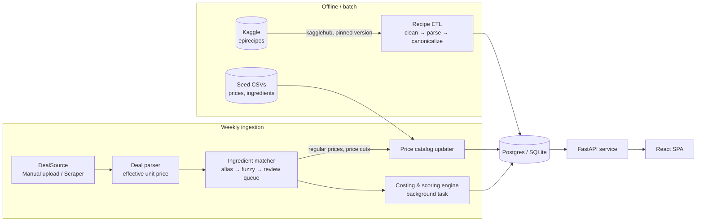
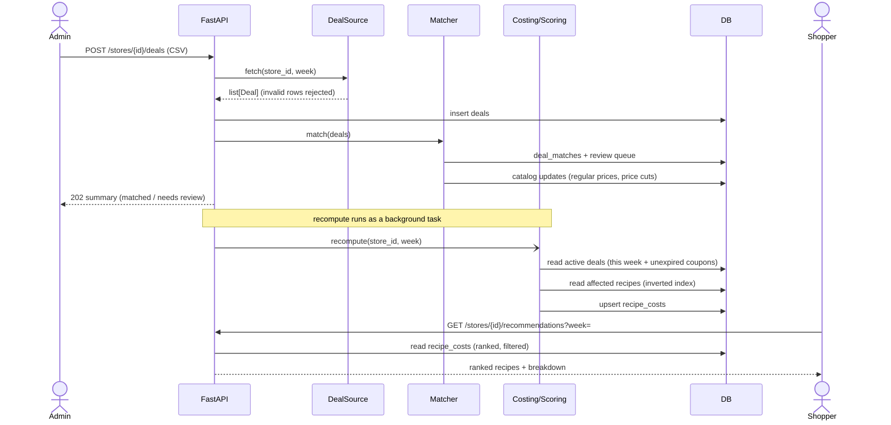
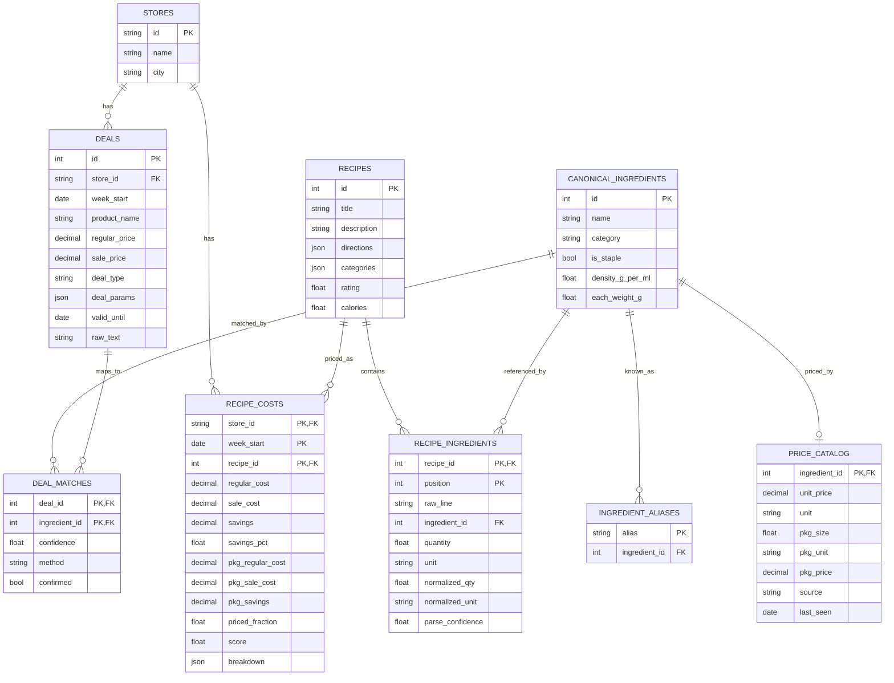

# Discount Recipes — Design Document

| | |
|---|---|
| **Status** | Draft (revision 2: review feedback incorporated) |
| **Author** | jeffclai7 |
| **Last updated** | 2026-10-17 |

---

## 1. Overview

Grocery prices change every week, but turning *"what's on sale at my H-E-B"* into *"what should I cook"* is still done by hand. **Discount Recipes** takes the weekly deals from a chosen H-E-B store, matches them against a recipe dataset, and ranks recipes by how much money the current sales save on them.

**Input:** a store and that store's deals for the week.
**Output:** a ranked list of recipes. Each one shows its estimated savings in dollars, the percentage saved on the recipe's cost, what you'd pay at checkout, and which ingredients are on sale.

> *Save ~$4.80 (31%) — Chicken Fajitas: chicken thighs 40% off, bell peppers $0.50 each. Recipe uses ~$10.60 · At checkout ~$18.25.*

The recipe data comes from the Kaggle dataset **[Epicurious – Recipes with Rating and Nutrition](https://www.kaggle.com/datasets/hugodarwood/epirecipes)**. It was chosen over larger datasets such as Food.com because its ingredient lines are expected to include **quantities**, which makes dollar estimates possible rather than only a relative score.

## 2. Goals and non-goals

### Goals
- Let a user pick an H-E-B store and see the recipes that give the most value from that week's sales.
- Load weekly deals through a **pluggable source**: a common `DealSource` interface (§4.2), so the way deals arrive (manual upload today, perhaps a scraper later) can change without touching matching, costing or ranking. v1 starts with a manual CSV/JSON upload.
- Parse recipe ingredient lines into quantity, unit and ingredient, and convert them to standard units.
- Match deals to ingredients, and estimate each recipe's **regular cost**, **sale cost** and **savings**, both for the **amount the recipe uses** and for **what you'd pay at checkout** buying whole packages.
- Rank recipes by value. Filter by dietary category, minimum rating and maximum estimated cost.
- Explain every recommendation with a cost breakdown per ingredient.
- Show solid engineering: typed code, automated tests, CI/CD and a deployed demo.

### Non-goals (v1)
- User accounts, saved preferences or a personal pantry.
- Shopping-list export or ordering online.
- Grocery chains other than H-E-B.
- Filtering by cook time (the dataset has no time field).
- Exact prices for every ingredient. Ingredients we can't price are marked **unpriced**, not guessed.

## 3. User stories

| As a… | I want to… | So that… |
|---|---|---|
| Shopper | pick my H-E-B store and see the top recipes by savings this week | I can plan meals around the sales |
| Shopper | filter by category (e.g. *Vegetarian*), minimum rating and maximum cost | the results fit my diet and budget |
| Shopper | see each ingredient's quantity, its regular and sale cost, and what I'll pay at checkout for whole packages | I trust the estimate and know what I'll spend |
| Shopper | sort by checkout savings instead of the default score | I can find what saves the most at the register |
| Admin | download a template, fill in this week's deals and upload them for a store | the recommendations stay current |
| Admin | see invalid rows flagged before an upload is saved | bad data never reaches the database |
| Admin | review deals that didn't match an ingredient and map them by hand | matching gets better over time |
| Admin | view and edit the regular-price catalog | the cost estimates stay accurate |

## 4. Data sources

### 4.1 Epicurious recipes

| Property | Value |
|---|---|
| Kaggle ID | `hugodarwood/epirecipes` |
| Size | ~20k recipes (~90 MB) |
| Last updated | 2017-02 |
| License | Listed as **Unknown** |
| Primary file | `full_format_recipes.json` |

**Fields used** (from `full_format_recipes.json`): `title`, `desc`, `date`, `categories`, `ingredients`, `directions`, `calories`, `fat`, `protein`, `sodium`, `rating`.

`epi_r.csv` has the same recipes as about 680 yes/no category columns. We don't need it, because the JSON already has `categories`.

**Assumption to confirm in M1:** each ingredient is a free-text line that includes a quantity, e.g. `"2 (15-ounce) cans black beans, rinsed"`. The costing design depends on this.

**Known data-quality issues** (the ETL must handle all of them):
- duplicate titles and empty or all-null records
- extreme nutrition values (data entry errors)
- `rating` is one average with no rating count, and `0` probably means unrated
- no servings or cook-time fields

#### Getting the data
The dataset is downloaded with the Kaggle API, through the [`kagglehub`](https://github.com/Kaggle/kagglehub) library, inside the ETL:

```python
path = kagglehub.dataset_download(f"hugodarwood/epirecipes/versions/{DATASET_VERSION}")
```

- **The version is pinned**, so every environment loads the same data. Without a pinned version, kagglehub may contact Kaggle on every run to check for a newer one.
- **The cache lives inside the project.** kagglehub caches in `~/.cache/kagglehub` by default; we set `KAGGLEHUB_CACHE=data/kagglehub` (in `.env`, loaded by the ETL at startup) so the download stays in the project's gitignored `data/` folder. The first run downloads about 90 MB; later runs find that version in the cache and make no network calls.
- **Kaggle only serves files; it can't answer queries.** The ETL loads the data into our database, and the API server never calls Kaggle.
- **Credentials** (`KAGGLE_USERNAME` / `KAGGLE_KEY`, or `~/.kaggle/kaggle.json`) are needed only where the ETL runs.
- **Production** runs the ETL as a Render one-off job that loads Postgres (§10). It does not run when the server starts.
- **License:** because the license is unknown, no dataset content is ever committed or republished. That includes test fixtures and evaluation files (see below and §11). The README credits the source.

#### Test fixtures
CI never downloads the dataset and never needs Kaggle secrets. Tests use about 50 **handwritten, made-up recipes** in the same JSON format, stored in `backend/tests/fixtures/recipes_sample.json`. Because they're written by hand, they're free of license concerns, and every edge case is there on purpose:

- package sizes inside a quantity (`2 (15-ounce) cans`)
- ranges (`2–3 garlic cloves`) and mixed fractions (`1 1/2 pounds`)
- lines with no quantity (`salt and freshly ground pepper`)
- volume-measured ingredients that need a density (`2 cups flour`) and counted ones that need an each-weight (`2 onions`)
- an ingredient with no conversion data (to produce **unpriced**)
- a duplicate recipe, an empty record, an unrated recipe (`rating = 0`) and an extreme calorie value

### 4.2 H-E-B weekly deals

H-E-B has no public API, and deals differ by store and region. The **ad week runs Wednesday to Tuesday**.

Deals are loaded through an **interface**, a contract that says *what* a deal source must do, not *how*:

```python
class DealSource(Protocol):
    def fetch(self, store_id: str, week_start: date) -> list[Deal]: ...
```

Any class with a matching `fetch` method counts as a `DealSource` (checked by mypy), and the rest of the pipeline only ever calls `source.fetch(...)`:

| Adapter | Phase | Notes |
|---|---|---|
| `ManualUploadSource` | v1 | Reads an uploaded CSV/JSON file (§4.2.1) |
| `FakeDealSource` | Tests | Returns a fixed list of deals |
| `WeeklyAdScraperSource` | Stretch | A Playwright scraper for the store's weekly ad. Opt-in, rate-limited, cached, and follows robots.txt and the site's ToS |

**`Deal` schema** (a Pydantic model, so every field is validated when it's loaded)

| Field | Type | Example |
|---|---|---|
| `store_id` | str | `"heb-austin-123"` |
| `week_start` | date | `2026-10-14`, the **Wednesday** the ad week begins (it ends the following Tuesday) |
| `product_name` | str | `"H-E-B Boneless Skinless Chicken Thighs Value Pack"` |
| `brand` | str? | `"H-E-B"` |
| `size_qty` / `size_unit` | float? / str? | `3.0` / `"lb"` |
| `price_basis` | enum | `each` \| `per_lb` \| `per_pkg` |
| `regular_price` | decimal? | `3.49` |
| `sale_price` | decimal? | `2.09` |
| `deal_type` | enum | see below |
| `deal_params` | json? | `{"n": 4, "x": 2.00}` for "4 for $2"; built from the upload's flat columns |
| `valid_until` | date? | `2026-10-23`; set for coupons, which show an end date |
| `raw_text` | str | the original ad text, kept for debugging |

**Deal types.** The type comes from the ad's own label. In v1 the admin enters it in the upload CSV; a future scraper would read the label automatically.

| `deal_type` | Meaning | Counts as a sale? |
|---|---|---|
| `sale_price` | Temporary sale: "now $X, was $Y" | Yes |
| `pct_off` | Temporary sale: "X% off" | Yes |
| `bogo` | Buy one, get one free | Yes |
| `n_for_x` | "4 for $2" | Yes |
| `digital_coupon` | Coupon with its own end date | Yes |
| `price_cut` | **Long-term** H-E-B price reduction | **No.** It becomes the item's new regular price (§4.3) |

**Which week a deal applies to:**
- A deal without `valid_until` applies only to its own `week_start` week.
- H-E-B shows a coupon's end date but not its start date, so a coupon applies from the week it was **first uploaded** through `valid_until`. It **carries over** into later weeks' recomputes until it expires. If the same coupon appears in a later upload, the newer row replaces the older one.
- A coupon that expires mid-week still counts for that week, but the UI shows an "ends Fri 10/23" badge (§7.5, §9).

#### 4.2.1 Upload file format
The admin uploads a **CSV** (a JSON array with the same fields is also accepted). The **store and week are chosen on the upload form**, not repeated on each row. The columns are flat, so the file is easy to fill in a spreadsheet; the parser builds `deal_params` from them. Columns that don't apply to a row's deal type are left blank.

```csv
product_name,brand,size_qty,size_unit,price_basis,regular_price,sale_price,deal_type,pct_off,n_for,x_price,coupon_amount,valid_until
H-E-B Boneless Skinless Chicken Thighs,H-E-B,3,lb,per_lb,3.49,2.09,sale_price,,,,,
Fresh Red Bell Pepper,,1,each,each,1.25,,n_for_x,,4,2.00,,
Hill Country Fare Black Beans,Hill Country Fare,15,oz,per_pkg,0.98,,bogo,,,,,
H-E-B Shredded Mexican Blend Cheese,H-E-B,8,oz,per_pkg,2.48,,digital_coupon,,,,1.00,2026-10-23
H-E-B Whole Milk,H-E-B,1,gal,per_pkg,3.12,2.89,price_cut,,,,,
```

- **Chicken thighs:** a temporary sale, $3.49 → $2.09 per lb.
- **Red bell peppers:** 4 for $2.00 = $0.50 each.
- **Black beans:** buy one, get one free.
- **Cheese:** a $1.00 coupon. Uploaded for the week of Wed 10/14, it carries over into the week of 10/21 and expires that Friday.
- **Milk:** a long-term price cut. It updates the regular price and is not a sale.

A blank template lives at `seed/deals_template.csv` and can be downloaded from the upload page. Uploads are validated first: the page shows a preview with invalid rows flagged (e.g. a missing price, an unknown `deal_type`, `n_for_x` without `n_for`), and nothing is saved until the file is valid.

### 4.3 Regular-price catalog

To calculate savings and percent saved, we need regular prices for **every** ingredient, not only the ones on sale. The `price_catalog` stores, for each canonical ingredient, a unit price, the typical package size and its price, where the price came from and when it was last seen. Its inputs:

1. **A seed CSV** (`source = "seed"`): about 150 common H-E-B items priced by hand, committed to the repo.
2. **Deals** (`source = "deal"`): each regular price seen in a weekly deal updates the catalog.
3. **Price cuts** (`source = "price_cut"`): a long-term price cut **becomes the new regular price**, so costs reflect what the item now normally costs.
4. **Manual edits** (`source = "manual"`) from the admin page.

Each update records `last_seen = week_start`.

## 5. System architecture



| Component | Responsibility |
|---|---|
| **Recipe ETL** | Download the pinned dataset, remove duplicates and bad records, parse ingredient lines, map names to canonical ingredients, write recipes plus an inverted index from ingredient to recipes |
| **Deal parser** | Validate uploaded rows, build `Deal` objects, and turn each into an effective unit price in base units ($/g, $/ml, $/each) |
| **Ingredient matcher** | Map deal product text to canonical ingredients; send matches with low confidence to the review queue |
| **Price catalog updater** | Record regular prices seen in deals, and apply price cuts as new regular prices |
| **Costing & scoring engine** | For each (store, week), estimate amount-used and checkout costs for affected recipes, rank them, and save the results with their breakdown |
| **FastAPI service** | Read-only recommendation endpoints and admin endpoints for writes |
| **React SPA** | Store picker, recommendations, recipe detail, admin tools |

### Weekly update flow



The API replies with `202 Accepted` as soon as matching finishes, so the admin sees the matched / needs-review summary right away. Costing and scoring then run as a FastAPI background task. If that gets slow it can move to a worker queue (e.g. RQ or Celery), but with about 20k recipes it should finish in seconds.

All heavy work happens **once, when deals are uploaded**. Shopper requests only read precomputed results with one indexed query.

## 6. Data model



**Field notes:**
- **`week_start`** is the Wednesday the ad week begins. `store_id` + `week_start` together mean "this store's deals this week".
- **`RECIPE_INGREDIENTS`** is keyed by `(recipe_id, position)`. `position` is the line's order in the recipe, used to display ingredients in their original order. It's part of the key because the same ingredient can appear twice (butter for the crust and butter for the filling). `raw_line` keeps the original text for display, for debugging, and so lines can be re-parsed without downloading again.
- **`DEAL_MATCHES`** is keyed by `(deal_id, ingredient_id)`, because one deal can match several ingredients ("Red, yellow or orange bell peppers" → three ingredients). `confidence`, `method` and `confirmed` are described in §7.3.
- **`RECIPE_COSTS`** stores both cost models (§7.5, §7.6). `priced_fraction` and `breakdown` are described in §7.5–7.6.

**Indexes:** `recipe_ingredients(ingredient_id)` (the inverted index), `recipe_costs(store_id, week_start, score DESC)`, `deals(store_id, week_start)` and `deals(deal_type, valid_until)` (to find coupons that carry over).

**Migrations:** SQLAlchemy 2.x models with Alembic migrations. SQLite locally, Postgres in production.

## 7. Core algorithms

### 7.1 Parsing ingredient lines
Each raw line is parsed with [`ingredient-parser-nlp`](https://github.com/strangetom/ingredient-parser) into **quantity, unit, name, preparation and comment**, with a confidence score. The library uses a trained sequence-labeling model (a CRF) rather than hand-written rules, because ingredient lines are written in too many ways for regular expressions to cover reliably.

| Input | Parsed |
|---|---|
| `1 1/2 pounds boneless chicken thighs` | 1.5 · lb · chicken thigh |
| `2 (15-ounce) cans black beans, rinsed` | 30 · oz · black beans (prep: rinsed) |
| `2–3 garlic cloves, minced` | 2.5 · each · garlic clove |
| `Salt and freshly ground pepper` | — · — · salt, black pepper → **staple** |

The library handles number formats, unit recognition and separating the name from preparation notes. Our code adds these rules:
- A range uses its midpoint. A nested package size multiplies out ("2 (15-ounce) cans" becomes 30 oz).
- A line with no quantity, or a name flagged `is_staple` (salt, pepper, water, cooking oil), is a **staple** and costs $0.
- Lines whose `parse_confidence` is below a threshold are treated as **unpriced** rather than costed with a bad number.
- The parsed name is mapped to a canonical ingredient by alias lookup, then fuzzy matching (the same matcher as in §7.3).

#### Building the canonical ingredient list
A **canonical ingredient** is the one standard name (e.g. `chicken thigh`) that both recipe lines and deal products map to. Recipes and deals never match each other directly; they meet at this table. Epicurious doesn't ship an ingredient list, so we build one in M2:

1. Run the parser over every recipe and collect the parsed names.
2. Count the distinct names and take the most frequent ones that together cover most ingredient lines.
3. Merge near-duplicates ("chicken thighs", "boneless chicken thighs") using rapidfuzz clustering plus manual curation. The variants become `ingredient_aliases`.
4. Assign each entry its `category`, `is_staple`, `density_g_per_ml` and `each_weight_g`.
5. Rarer names are fuzzy-matched to the list or left unmapped, which makes them **unpriced**.

The result is committed as `seed/canonical_ingredients.csv` (our own curated list, not dataset content).

### 7.2 Unit normalization
Recipes and stores often measure the same thing differently ("2 cups flour" vs. "$3.49 per 5 lb bag"), and a quantity can't be multiplied by a price until the units match. [`pint`](https://pint.readthedocs.io/) converts every quantity to one base unit per ingredient:
- **Weight:** grams
- **Volume:** ml, converted to grams with `density_g_per_ml` when the price is by weight. Example: 2 cups = 473 ml × 0.53 g/ml ≈ 251 g of flour; 251 g of a 2,268 g (5 lb) bag at $3.49 ≈ **$0.39**.
- **Count:** each, converted to grams with `each_weight_g` when needed. Example: 2 onions × 150 g = 300 g ≈ 0.66 lb at $0.99/lb ≈ **$0.65**.

If a conversion isn't possible (no density or each-weight), the ingredient is marked **unpriced**. The system never makes up a number.

### 7.3 Matching deals to ingredients
1. **Normalize** the product text: lowercase; remove the brand ("H-E-B", "Hill Country Fare"), sizes, units and marketing words ("value pack", "family size", "fresh").
2. **Exact alias lookup** in `ingredient_aliases`. This also covers synonyms that fuzzy matching can't see (scallions → green onion).
3. **Fuzzy match** with [`rapidfuzz`](https://github.com/rapidfuzz/RapidFuzz) `fuzz.token_set_ratio` against canonical names and aliases (via `process.extractOne`). `token_set_ratio` ignores word order and extra words, which suits store product names.
4. **Threshold:** a score ≥ 90 is accepted automatically. 75–89 is accepted but flagged for review. Below 75 the deal goes to the **review queue** unmatched.
5. When an admin resolves a deal in the queue, the answer is saved as a new alias, so the same product matches automatically next week.

**`DEAL_MATCHES` fields:**
- **`method`:** `alias`, `fuzzy` or `manual`. Used for debugging and evaluation.
- **`confidence`:** 0–100. For fuzzy matches it is the rapidfuzz score; alias and manual matches are 100.
- **`confirmed`:** whether a human has checked the match. Re-running the matcher (e.g. after improving normalization) **never overwrites confirmed matches**, and confirmed matches double as evaluation labels (§11).

The **review queue** is every deal with no match, plus every unconfirmed match with confidence below 90.

### 7.4 Effective sale unit price

| `deal_type` | Effective price |
|---|---|
| `sale_price` | `sale_price` |
| `pct_off` | `regular × (1 − pct)` |
| `bogo` | `regular × 0.5` (assumes you buy 2) |
| `n_for_x` | `x / n` per item |
| `digital_coupon` | `regular − coupon_amount` |
| `price_cut` | **Not a sale.** No effective sale price; it updates the catalog's regular price (§4.3) |

The result is converted to a **price per base unit** using `size_qty`, `size_unit` and `price_basis`.

### 7.5 Costing (amount used)
For a given (store, week), the **active deals** are that week's deals plus coupons from earlier uploads that haven't expired (§4.2). `price_cut` deals are never active sales. For each recipe with at least one ingredient on an active sale:

```
cost_i(regular) = normalized_qty_i × regular_unit_price_i      (from deal or catalog)
cost_i(sale)    = normalized_qty_i × effective_unit_price_i    (sale price if on sale, else regular)

regular_cost    = Σ cost_i(regular)
sale_cost       = Σ cost_i(sale)
savings         = regular_cost − sale_cost
savings_pct     = savings / regular_cost
priced_fraction = (# non-staple ingredients with a price) / (# non-staple ingredients)
```

**`priced_fraction`** matters because unpriced ingredients are left out of the totals, which understates them. Example: 8 non-staple ingredients, 7 priced → 0.875. Recipes with `priced_fraction < 0.6` are hidden by default (this is configurable), and the UI shows coverage, e.g. "estimate covers 7 of 8 ingredients".

A coupon that expires mid-week still counts for the whole week, but its breakdown entry carries `ends_on` so the UI can show an "ends Fri 10/23" badge.

### 7.6 Checkout cost (whole packages)
The amount-used model treats leftovers as free, but a shopper has to buy whole packages. Checkout cost is therefore **always computed and always shown** next to the amount-used cost:

```
packages_i          = ceil(normalized_qty_i / pkg_size_i)
pkg_regular_cost    = Σ packages_i × regular_pkg_price_i
pkg_sale_cost       = Σ packages_i × sale_pkg_price_i       (= what you pay at checkout)
pkg_savings         = pkg_regular_cost − pkg_sale_cost
```

Package sizes come from the deal (`size_qty`/`size_unit`) for items on sale and from `price_catalog.pkg_size` otherwise.

Each `recipe_costs` row stores a **`breakdown`** JSON: a snapshot of the per-ingredient calculation, read directly by the recipe detail page:

```json
[
  { "raw_line": "1 1/2 pounds boneless chicken thighs", "ingredient": "chicken thigh",
    "qty": 680, "unit": "g", "regular_cost": 5.24, "sale_cost": 3.14,
    "packages": 1, "pkg_regular_price": 10.47, "pkg_sale_price": 6.27,
    "deal_id": 501, "status": "on_sale" },
  { "raw_line": "1 cup shredded Mexican blend cheese", "ingredient": "mexican cheese blend",
    "qty": 113, "unit": "g", "regular_cost": 1.24, "sale_cost": 0.74,
    "packages": 1, "pkg_regular_price": 2.48, "pkg_sale_price": 1.48,
    "deal_id": 504, "status": "on_sale", "ends_on": "2026-10-23" },
  { "raw_line": "1 tsp sumac", "ingredient": "sumac", "status": "unpriced" },
  { "raw_line": "Salt to taste", "ingredient": "salt", "status": "staple" }
]
```

### 7.7 Ranking

```
score = α · minmax(savings) + β · savings_pct + γ · minmax(rating)
        default α = 0.5, β = 0.3, γ = 0.2   (configurable)
```

The default score uses **amount-used** savings. Shoppers can sort by `pkg_savings` (checkout savings) instead (§8, §9).

**`minmax()`** is min-max normalization: it rescales values to 0–1 so dollars, percentages and ratings can be combined, and so the weights mean what they say.

```
minmax(x) = (x − min) / (max − min)
```

- `min` and `max` are taken over the **eligible recipes for that (store, week)**, so scores rank recipes within a week and aren't comparable across weeks.
- Values are first **capped at the 5th and 95th percentiles**, so one outlier (e.g. a $40 brisket saving) doesn't squash every other recipe toward 0.
- `savings_pct` is already 0–1, so it isn't rescaled.

Worked example: savings range $0.50–$12.50 and ratings 1.25–5. A recipe saving $6.50 (31%) rated 4.375 scores `0.5 × 0.50 + 0.3 × 0.31 + 0.2 × 0.83 ≈ 0.51`.

**Eligibility filters:**
- at least one **anchor** ingredient: on an active **sale** (never a `price_cut`), not a staple, with a sale saving of at least $0.50 in this recipe
- `priced_fraction ≥ 0.6`
- unrated recipes (`rating = 0`) get the dataset median rating so they aren't buried

### 7.8 Performance
- The inverted index (`recipe_ingredients.ingredient_id`) limits costing to recipes that contain at least one on-sale ingredient.
- Results are precomputed per (store, week), so serving a request is one indexed query.
- With about 20k recipes, a full recompute should finish in seconds.

## 8. API design

[FastAPI](https://fastapi.tiangolo.com/) with Pydantic models. FastAPI reads type hints to validate requests (e.g. `limit=abc` → 422) and serialize responses, and generates interactive OpenAPI docs at `/docs`. It runs on the uvicorn server.

| Method | Path | Description |
|---|---|---|
| `GET` | `/health` | Liveness check (used by Render) |
| `GET` | `/stores` | List stores |
| `POST` | `/stores/{store_id}/deals?week=&dry_run=` | Upload deals (CSV/JSON). With `dry_run=true`, only validates and returns per-row errors (the upload preview). Otherwise saves, matches, returns `202` and starts the recompute *(admin)* |
| `GET` | `/stores/{store_id}/deals?week=` | List active deals with their matches |
| `GET` | `/stores/{store_id}/recommendations` | Ranked recipes (see the query parameters below) |
| `GET` | `/recipes/{recipe_id}?store_id=&week=` | Recipe detail with the per-ingredient cost breakdown |
| `GET` | `/admin/deals/template.csv` | Download the blank upload template *(admin)* |
| `GET` | `/admin/unmatched-deals?store_id=&week=` | Review queue *(admin)* |
| `POST` | `/admin/aliases` | Resolve a deal to an ingredient by adding an alias *(admin)* |
| `GET` / `PUT` | `/admin/price-catalog` | View and edit regular prices *(admin)* |

**Recommendations query parameters:** `week`, `categories` (repeatable), `min_rating`, `max_cost`, `sort=score|savings|savings_pct|pkg_savings`, `limit` (default 20, max 100), `offset`.

**Example response:**

```json
{
  "store_id": "heb-austin-123",
  "week_start": "2026-10-14",
  "total": 412,
  "items": [
    {
      "recipe_id": 1832,
      "title": "Chicken Fajitas",
      "rating": 4.375,
      "regular_cost": 15.40,
      "sale_cost": 10.60,
      "savings": 4.80,
      "savings_pct": 0.31,
      "pkg_regular_cost": 23.35,
      "pkg_sale_cost": 18.25,
      "pkg_savings": 5.10,
      "priced_fraction": 0.89,
      "on_sale": [
        { "ingredient": "chicken thigh", "deal": "$2.09/lb (was $3.49)", "savings": 3.20 },
        { "ingredient": "bell pepper", "deal": "4 for $2", "savings": 1.60 }
      ]
    }
  ]
}
```

**Admin auth (v1):** one admin API key, checked by a FastAPI dependency. Accounts and roles are out of scope.

## 9. Frontend

[React](https://react.dev/) + TypeScript, built with [Vite](https://vite.dev/):
- **React** builds the UI from reusable components (e.g. `RecipeCard`) and updates only what changes.
- **Vite** is the dev server (instant reloads on save) and the production bundler.
- **[TanStack Query](https://tanstack.com/query)** handles API calls: loading and error states, caching, refetching when filters change, and mutations for admin writes.
- **[React Router](https://reactrouter.com/)** maps URLs to pages. Filters and sort live in the URL, so views can be bookmarked and shared and the back button works.

| Page | Contents |
|---|---|
| **Store picker** | Search or select an H-E-B store; the choice is remembered in `localStorage` |
| **Recommendations** | A grid of cards. Each shows a **"$ saved · % saved"** badge, **"Recipe uses ~$X · At checkout ~$Y"**, the rating, on-sale ingredient chips, and an "ends Fri 10/23" badge for expiring coupons. A filter sidebar (categories, minimum rating, maximum cost) and a sort control (Best value, $ saved, % saved, **Checkout savings**) |
| **Recipe detail** | Description, directions, nutrition, and a **cost table** per ingredient showing the amount-used and checkout (whole packages) columns **side by side**, with totals for both. Unpriced and staple ingredients are marked, and so is coverage ("covers 7 of 8 ingredients") |
| **Admin: upload deals** | Store and week selector, a **Download template** button, file upload, a **preview that flags invalid rows** (`dry_run`), then a matched / needs-review summary |
| **Admin: match review** | The queue of unmatched or low-confidence deals, with a search box to assign each one to a canonical ingredient |
| **Admin: price catalog** | An editable table of regular prices with `source` and `last_seen` |

## 10. Engineering practices

### Repository layout
```
discount-recipes/
├── backend/
│   ├── app/          # FastAPI routers, schemas, dependencies
│   ├── etl/          # kagglehub download, cleaning, loading
│   ├── parsing/      # ingredient line parsing + unit normalization
│   ├── deals/        # DealSource adapters + deal parser
│   ├── matching/     # alias + fuzzy matcher
│   ├── costing/      # costing + scoring engine
│   ├── db/           # SQLAlchemy models, Alembic migrations
│   ├── eval/         # evaluation scripts + label files (§11)
│   └── tests/        # pytest; fixtures/ holds handwritten recipes + a sample deals week
├── frontend/
│   ├── src/
│   └── e2e/          # Playwright smoke test
├── data/             # gitignored: kagglehub cache (data/kagglehub), intermediate files
├── seed/             # canonical_ingredients.csv, price_catalog_seed.csv, densities.csv, deals_template.csv
├── docs/             # DESIGN.md
├── render.yaml       # Render blueprint (API, Postgres, static site)
├── docker-compose.yml
└── .env.example      # KAGGLEHUB_CACHE=data/kagglehub, KAGGLE_*, DATABASE_URL, ADMIN_API_KEY
```

The ETL entry point is `python -m backend.etl --dataset-version <N>`.

### Testing
- **Unit tests (pytest):** fast, isolated, table-driven (`@pytest.mark.parametrize`) tests:
  - **Ingredient parsing + unit conversion**, against a **golden set** of about 100 **handwritten** lines committed in `backend/tests/` (e.g. `"2 (15-ounce) cans"` → 850.5 g; `"salt to taste"` → staple). This is separate from the evaluation set in §11.
  - **Deal parser**, for every `deal_type` (4 for $2 → $0.50 each; BOGO → 50%; `price_cut` → no sale, catalog updated; coupon carry-over and expiry).
  - **Matcher** thresholds and edge cases.
  - **Costing and scoring math** against hand-calculated answers: amount-used and checkout totals, `priced_fraction`, the `minmax` percentile cap, and a `price_cut` producing $0 savings.
- **API tests:** `httpx.AsyncClient` against the app on a temporary SQLite DB loaded from the fixtures. They cover status codes (422 bad input, 401 missing admin key, 404 unknown store), filtering and sorting, `dry_run` validation, and the 202 upload flow.
- **Frontend tests:** Vitest + Testing Library, with the API mocked (e.g. MSW). They cover card display (both costs, badges, unpriced markers), filters and sort, and the upload preview flagging bad rows.
- **End-to-end smoke test (Playwright, added in M5):** one test against the real frontend and a backend on a fixture-seeded SQLite DB with a test admin key. It uploads the sample deals CSV, waits for the background recompute, checks that recommendation cards with savings badges appear, and opens a recipe to check its cost table. It's the only test proving all the parts work together; there's deliberately just one, because browser tests are slower and more fragile.
- **Fixtures:** the handwritten recipes from §4.1 plus a sample week of deals, so every test can assert exact numbers.

### Code quality
- Python: `ruff` (lint and format) and `mypy --strict` on the backend packages.
- TypeScript: ESLint and Prettier, with `tsc --noEmit`.
- `pre-commit` hooks run all of the above.

### CI/CD
**GitHub Actions** runs on every push and pull request, using `.github/workflows/ci.yml`. It has three jobs:
1. **backend:** ruff → mypy → pytest with coverage
2. **frontend:** ESLint → tsc → Vitest → `vite build`
3. **e2e:** install Chromium → start the app → run Playwright → upload the trace if it fails

Branch protection on `main` requires all three to pass. CI never needs Kaggle credentials.

### Deployment (Render)
Everything is hosted on [Render](https://render.com/), defined in a `render.yaml` blueprint and **set up in M1** (deploy early):
- **API:** a Render web service built from the backend's Dockerfile, with `/health` as its health check.
- **Database:** Render Postgres. Alembic migrations run on deploy.
- **Frontend:** a Render static site serving the `vite build` output, with an SPA rewrite rule (`/*` → `/index.html`) so React Router URLs work on refresh.
- **CORS:** the API allows the static site's origin.
- **Auto-deploy:** merges to `main` deploy automatically once CI passes.
- **ETL:** runs as a Render one-off job with `KAGGLE_USERNAME` / `KAGGLE_KEY` stored as secrets.
- **Free tier caveats:** the free web service sleeps when idle, so the first visit after a quiet period is slow to wake, and the free Postgres tier has limits. Check current pricing; upgrading is a configuration change, not a code change.

Locally, `docker compose up` starts Postgres, the API and the frontend.

### Non-functional targets

| Metric | Target |
|---|---|
| Recommendations p95 latency (precomputed, service awake) | < 300 ms |
| Full ETL (download from cache → DB) | < 5 min |
| Weekly recompute for one store | < 30 s |
| Backend test coverage (`pytest-cov`) | ≥ 80% on `parsing`, `matching`, `costing` |

## 11. Evaluation

The evaluations are one-off measurements of how well each part works on **real data**, run locally with scripts in `backend/eval/`. They're separate from the automated tests in §10: the **golden test set** is handwritten, committed and run in CI to catch regressions, while the **evaluation sets** below are drawn from real data to measure real-world accuracy.

| What | Milestone | You label / calculate | Metric | Target (v1) | Effort |
|---|---|---|---|---|---|
| Ingredient parsing | M2 | ~200 random real lines | Exact-match rate for quantity / unit / name | ≥ 90% / 90% / 85% | 3–4 h |
| Deal matching | M3 | ~200 real deals | Precision, recall | ≥ 95%, ≥ 80% | 1–2 h |
| Cost estimates | M4 | ~10 recipes, priced on heb.com | Mean absolute % error (amount-used and checkout) | ≤ 20% | 3–5 h |
| Ranking | M4 | Scenarios + a manual review | Tests pass; written review | Pass | 1 h / week |

### Ingredient parsing
- **Labels:** for about 200 lines sampled at random from the real dataset, write the expected quantity, unit and canonical name (or "staple").
- **License:** the label file stores only references and answers: `recipe_id, position, expected_qty, expected_unit, expected_name`. The script reads the raw text from the local download, so no dataset text is committed.
- **Output:** per-field exact-match rates, plus a list of misses showing what to fix. A shortcut is to pre-fill rows with the parser's output and correct them, but check each field deliberately.

### Deal matching
- **Labels:** about 200 deals from 2–3 weeks of real H-E-B uploads, each with the canonical ingredient(s) it should match, or **none** for non-food items and things no recipe uses (paper towels, soda). Every match resolved in the review queue is `confirmed` and becomes a label automatically.
- **Precision:** of the matches the system made, how many were right. Low precision means wrong recommendations.
- **Recall:** of the deals that should match, how many it matched automatically. Low recall means missed savings and more manual review.
- **Using the results:** the numbers are used to tune the 75/90 thresholds. Raising a threshold usually raises precision and lowers recall; the target favors precision, because a wrong match damages trust more than a missed one.

### Cost estimates
- **Calculation:** pick about 10 varied recipes (meat main, vegetarian, soup, baked good, salad). Using real heb.com prices for your store from the **same week** as the uploaded deals, fill in a spreadsheet per ingredient: product, price, package size, amount-used cost, packages to buy and checkout cost.
- **Output:** for each recipe, `|system − spreadsheet| / spreadsheet` for **both** totals, averaged over the recipes. Large errors usually trace back to one cause (a density, a package size, a bad match or a missing price), which becomes a fix.

### Ranking
1. **Automated (in CI, pass/fail):** scenario tests on the fixture data:
   - chicken thighs 50% off → chicken-thigh recipes are in the top 5
   - no deals → no recommendations
   - only `price_cut` deals → no recommendations
   - one extreme saving → other recipes still get spread-out scores

   A **golden-file test** also saves the expected top-10 list for the fixture week. Any change to the ranking fails the test and shows the difference, which you either fix or accept by updating the file.
2. **Manual (judgment):** for each real week, look at the top 20 and ask *would I cook these, and do the savings look believable?* Write down anything clearly wrong and why (e.g. "#7 boosted by a bad match: chicken broth → chicken thigh"). Each note usually becomes a fix or a new alias. Summarize the results in the README (e.g. "week of 10/14: 17 of the top 20 sensible; 3 issues fixed").

## 12. Risks and mitigations

| Risk | Impact | Mitigation |
|---|---|---|
| Ingredient lines lack reliable quantities (assumption in §4.1 is wrong) | High | Confirm in M1 before building costing. If wrong, fall back to a relative score weighted by ingredient category |
| H-E-B ToS and anti-bot measures | High | Manual upload is the v1 source; the scraper is opt-in, rate-limited and cached |
| Ingredient parsing errors | Medium | Confidence threshold, the golden test set, the parsing evaluation, and the unpriced fallback |
| Building the canonical ingredient list takes longer than expected | Medium | Start with the most frequent names; leave the rest unpriced; show coverage openly |
| Missing density, each-weight or package-size data | Medium | A small curated table to start; show `priced_fraction`; grow the table starting with the most common unpriced ingredients |
| Deal type mislabeled at upload (e.g. a price cut entered as a sale) | Medium | Upload preview, a clear template, and catalog history (`source`, `last_seen`) to spot odd changes |
| Stale or missing regular prices | Medium | Track `last_seen`; update the catalog from every week's deals and price cuts |
| Small (~20k) and old (2017) dataset | Low | Enough for v1; a second dataset is future work |
| Dataset license is "Unknown" | Medium | Download with kagglehub during the ETL; never commit dataset content (handwritten fixtures, reference-only evaluation labels); credit the source |
| Kaggle down, rate-limiting, or the dataset removed | Low | Pin the version and keep the in-project cache; once the ETL has run, the app depends only on the DB |
| Render free tier sleeps or limits change | Low | Acceptable for a demo; note it in the README; upgrading is a config change |
| Data quality (duplicates, nulls, outliers) | Low | A cleaning stage in the ETL that logs counts of dropped and capped records |

## 13. Milestones

| Milestone | Scope | Exit criteria |
|---|---|---|
| **M1: Foundation** | Repo scaffold, CI, Docker Compose, **hello-world deploy to Render** (API `/health` + placeholder frontend, auto-deploy on merge), ETL with the pinned kagglehub download into `data/kagglehub` and cleaning, handwritten test fixtures | **Live URL**; `docker compose up` works; recipes in the DB; quantity assumption confirmed |
| **M2: Ingredient parsing** | Line parsing, unit normalization, **building the canonical ingredient list**, staples, density and each-weight tables, golden test set | Golden tests pass; parsing evaluation reported |
| **M3: Deals** | `DealSource` + `ManualUploadSource`, upload format, template and `dry_run` validation, deal parser (including `price_cut` and coupon carry-over), matcher, review queue | Matching evaluation reported; sample week loads cleanly |
| **M4: Costing & API** | Price catalog, amount-used and checkout costing, ranking, all API endpoints | Recommendations endpoint returns explained results for the sample week; cost and ranking evaluations reported |
| **M5: Frontend** | All pages, including both cost columns and the admin tools; **Playwright smoke test and the e2e CI job** | End-to-end demo with the sample data; e2e job green |
| **M6: Polish** | Polish the live demo, README with screenshots and the evaluation write-up | Public demo ready to share |

**Stretch:** the `WeeklyAdScraperSource` adapter; estimating servings from the recipe text to show cost per serving; a user pantry ("I already have X") that excludes owned ingredients from the cost; shopping-list export; price-history charts.

## 14. Open questions

1. How do we price ingredients that H-E-B rarely puts on sale (spices, specialty items)? The seed catalog may need periodic manual refreshes.
2. Can servings be estimated from `desc` and `directions` reliably enough to show cost per serving?
3. Coupons can expire mid-week. Should a daily job remove expired coupons and recompute, instead of counting them for the whole week with an "ends" badge?
4. Should the anchor-ingredient threshold ($0.50) and the ranking weights be exposed to users as an option?

## Appendix: Glossary

| Term | Meaning |
|---|---|
| **Canonical ingredient** | One standard name (e.g. `chicken thigh`) that both recipe lines and deal products map to |
| **Staple** | An ingredient assumed to be on hand (salt, pepper, water, oil); it costs $0 |
| **Anchor ingredient** | An ingredient on an active sale (not a price cut), not a staple, that saves meaningful money in a recipe |
| **Price cut** | A long-term H-E-B price reduction; it becomes the new regular price and isn't counted as a sale |
| **Active deals** | A week's deals plus earlier coupons that haven't expired |
| **Priced fraction** | The share of a recipe's non-staple ingredients that have a price |
| **Amount-used cost** | Cost of only the quantities the recipe calls for |
| **Checkout cost** | Cost of buying whole packages of each ingredient |
| **`week_start`** | The Wednesday an H-E-B ad week begins |
| **Min-max normalization** | Rescaling values to 0–1: `(x − min) / (max − min)` |
| **Fixture** | A small, fixed data file used by tests (here, handwritten) |
| **Golden set / golden file** | Committed expected outputs that tests compare against to catch regressions |
| **Evaluation set** | Hand-labeled real data used to measure accuracy, run locally |
